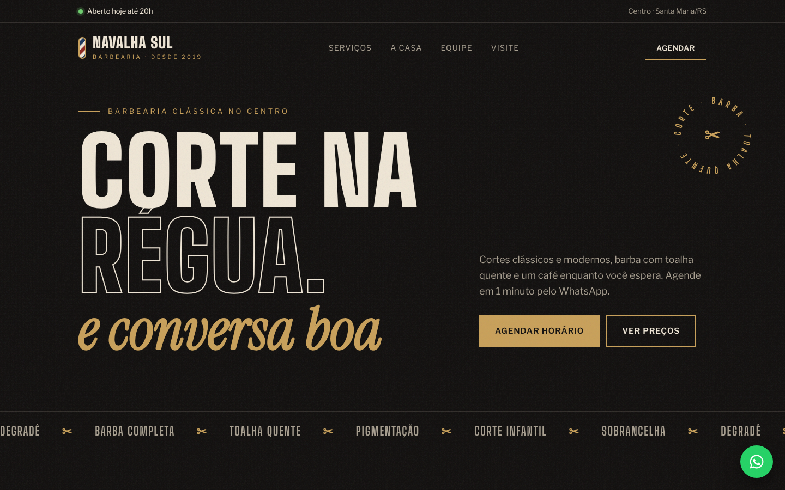

# ✂️ Navalha Sul — Site vitrine d'une barbearia

Site vitrine pour **Navalha Sul**, une barbearia fictive du centre de Santa Maria (RS). L'objectif : présenter les services et les prix, inspirer confiance et convertir les visiteurs en rendez-vous via WhatsApp.

🔗 **Démo en ligne :** [luc-arthur.github.io/site-barbearia-navalha-sul](https://luc-arthur.github.io/site-barbearia-navalha-sul/)



> ℹ️ Projet de démonstration pour mon portfolio : la marque, l'équipe et l'adresse sont fictives. Le contenu est en portugais du Brésil, la langue du public visé.

---

## ✨ Ce que contient le site

- **Barre d'info** avec statut d'ouverture
- **Hero** typographique avec badge circulaire animé et poteau de barbier en CSS
- **Carte des services** avec prix, façon menu de restaurant
- **Section « A casa »** avec illustration SVG et chiffres clés
- **Présentation de l'équipe**
- **Prise de rendez-vous en 3 étapes**
- **Horaires et plan d'accès** (carte illustrée en CSS)
- **Bouton WhatsApp flottant**, toujours visible

## 🎨 Choix de design

- Ambiance sombre et laiton, inspirée des barbearias classiques
- Trio typographique : **Big Shoulders Display** (titres), **Instrument Serif** italique (accents), **Libre Franklin** (texte)
- Texture de grain en SVG, animations au scroll et respect de `prefers-reduced-motion`

## 📱 Responsive


## 🛠️ Stack

HTML5 · CSS3 (variables, Grid, animations) · SVG · JavaScript natif. Aucune dépendance, un seul fichier.

## 🚀 Lancer en local

```bash
git clone https://github.com/Luc-Arthur/site-barbearia-navalha-sul.git
cd site-barbearia-navalha-sul
# Ouvrir index.html dans le navigateur
```

---

**Luc-Arthur LAWALE** · [LinkedIn](https://www.linkedin.com/in/luc-arthur-lawale-00a489334)
